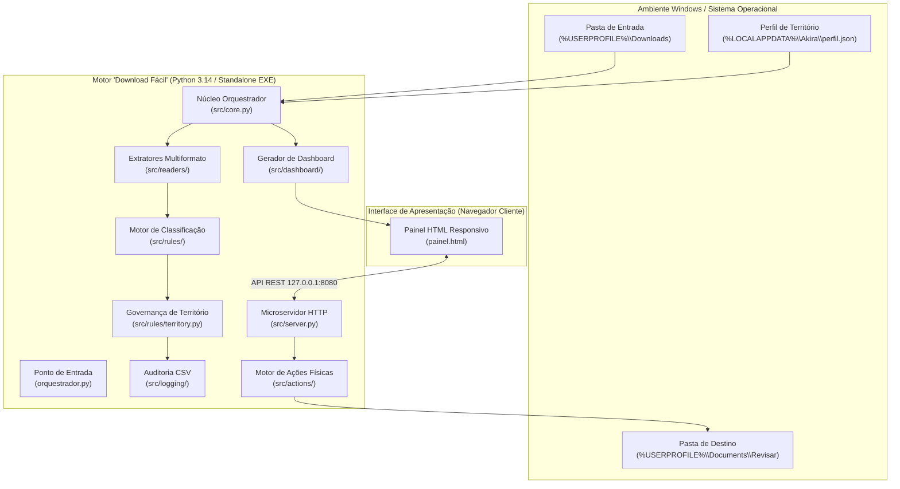

# Documentação Técnica de Engenharia de Software
# Sistema: Download Fácil
**Codinome do Repositório:** `orquestrador-downloads`  
**Versão Atual:** 1.0.0 (Modular / Standalone)  
**Padrão de Referência:** IEEE 1016 / ISO/IEC/IEEE 26514  
**Data da Documentação:** 23 de Novembro de 2026  

---

## 1. Visão Geral e Arquitetura de Alto Nível

### 1.1. Propósito do Sistema
O **Download Fácil** é uma solução de software desenvolvida para triagem, classificação documental, governança de diretórios e movimentação física assistida de arquivos baixados pelo usuário. O sistema opera sob o paradigma *local-first*, garantindo processamento em máquina cliente sem tráfego de dados para nuvens externas.

### 1.2. Princípios Arquiteturais Fundamentais
* **Segurança Operacional por Padrão (*Safety-First*):** Operação nativa em *Dry-Run* (análise e auditoria antes de qualquer ação física).
* **Processamento 100% Local (*Local-First*):** Nenhuma informação confidencial, metadado ou conteúdo de arquivo sai da máquina cliente (estrita conformidade com a LGPD).
* **Supervisão Humana Ativa (*Human-in-the-Loop*):** As heurísticas calculam sugestões e graus de confiança, cabendo ao usuário a homologação da movimentação.
* **Integridade Transacional de Arquivos:** Mecanismo rigoroso de prevenção de colisão de nomes (adicionando sufixos sequenciais `_1`, `_2`) e pilha de reversão (*Undo*).

### 1.3. Diagrama Geral de Arquitetura



---

## 2. Estrutura de Pacotes e Módulos

```text
c:\Projetos\orquestrador-downloads\
├── orquestrador.py              # Ponto de entrada CLI e lançador GUI
├── Iniciar_Orquestrador.bat     # Inicializador rápido de duplo clique
├── perfil.json                  # Perfil base de território e diretórios
├── requirements.txt             # Dependências consolidadas do projeto
├── pytest.ini                   # Configurações do executor de testes
├── dist/
│   └── Orquestrador.exe         # Binário standalone autônomo (PE32+)
├── src/
│   ├── __init__.py              # Metadados e versão do pacote
│   ├── config.py                # Configurações, caminhos dinâmicos e fallback
│   ├── core.py                  # Varredura, pipeline de análise e CLI
│   ├── server.py                # Servidor HTTP nativo e endpoints de API
│   ├── readers/                 # Extratores de conteúdo textual e mídia
│   │   ├── __init__.py          # Despachante unificado (ler_conteudo_textual)
│   │   ├── text_reader.py       # Leitor TXT com substituição de encoding
│   │   ├── docx_reader.py       # Leitor DOCX (parágrafos e tabelas estruturadas)
│   │   ├── pdf_reader.py        # Leitor PDF via pypdf com extração de páginas
│   │   ├── sheet_reader.py      # Leitor XLSX (openpyxl) e XLS (xlrd)
│   │   ├── ppt_reader.py        # Leitor PPTX (python-pptx)
│   │   └── preview_reader.py    # Geração de Data URIs Base64 para imagens/áudio
│   ├── rules/                   # Motor de inferência e normalização
│   │   ├── __init__.py          # Facade de regras
│   │   ├── normalizer.py        # Normalização fonética/acentuação (NFD)
│   │   ├── classifiers.py       # Identificação de tipo documental e assunto
│   │   └── territory.py         # Avaliação de autorização e destinos
│   ├── logging/                 # Registro de auditoria
│   │   ├── __init__.py
│   │   └── audit_logger.py      # Gravação de registros CSV em formato utf-8-sig
│   ├── dashboard/               # Interface e apresentação
│   │   ├── __init__.py
│   │   └── generator.py         # Compilador do painel HTML/CSS/JS integrado
│   └── actions/                 # Execução de efeitos colaterais no filesystem
│       ├── __init__.py
│       └── file_mover.py        # Movimentação física segura e pilha de reversão
├── tests/                       # Suíte de testes automatizados (pytest)
│   ├── test_normalizer.py       # Validação de regras de normalização
│   ├── test_classifiers.py      # Testes de heurística de tipo e assunto
│   ├── test_territory.py        # Testes de governança e detecção de conflitos
│   ├── test_readers.py          # Testes de extratores e tratamento de erros
│   ├── test_logger.py           # Validação da integridade dos registros CSV
│   ├── test_file_mover.py       # Testes de anti-colisão e função Desfazer
│   └── test_dashboard.py        # Teste de integração do gerador HTML
├── historico/                   # Versões legadas preservadas para auditoria
└── logs/                        # Arquivos CSV de auditoria em execução
    ├── decisoes.csv             # Log de todas as análises heurísticas
    └── movimentacoes.csv        # Log de todas as operações físicas executadas
```

---

## 3. Fluxo de Dados e Ciclo de Vida da Informação

O ciclo de processamento ocorre em 6 etapas determinísticas:

```mermaid
sequenceDiagram
    autonumber
    actor User as Usuário
    participant CLI as orquestrador.py
    participant Core as src.core
    participant Readers as src.readers
    participant Rules as src.rules
    participant Log as src.logging
    participant Server as src.server
    participant Action as src.actions
    participant FS as Sistema de Arquivos

    User->>CLI: Executa o programa (duplo clique ou terminal)
    CLI->>Core: Inicia varredura das pastas ativas
    Core->>FS: Lê metadados dos arquivos (tamanho, mtime, extensão)
    Core->>Readers: Extrai conteúdo textual (PDF, DOCX, XLSX, etc.)
    Core->>Rules: Executa heurísticas de normalização e classificação
    Rules-->>Core: Retorna Tipo, Assunto, Confiança e Evidências
    Core->>Rules: Avalia compatibilidade com o Território Documental
    Rules-->>Core: Retorna pasta sugerida ou SEM_DESTINO_SEGURO
    Core->>Log: Grava linha de auditoria em logs/decisoes.csv
    Core->>Core: Compila painel.html
    Core->>Server: Inicia servidor local em 127.0.0.1:8080
    Server-->>User: Abre navegador com o painel interativo

    opt Ação Homologada pelo Usuário
        User->>Server: POST /api/mover (arquivo_id, destino_id + token CSRF)
        Server->>Server: Valida Host, Origin, Content-Type e corpo JSON
        Server->>Server: Confere IDs e snapshots autorizados da análise
        Server->>Action: mover_arquivo_seguro()
        Action->>FS: Verifica colisão; gera nome_1 se existir
        Action->>FS: Move o arquivo fisicamente
        Action->>Log: Registra operação física em logs/movimentacoes.csv
        Action-->>Server: Retorna status de sucesso e nome final
        Server->>Core: Atualiza autorização, estado operacional e painel
        Server-->>User: Recarrega painel com estado e contadores sincronizados
    end

    opt Reversão de Ação (Desfazer)
        User->>Server: POST /api/desfazer (JSON + token CSRF)
        Server->>Server: Confere autorização da origem e do destino
        Server->>Action: desfazer_ultima_movimentacao()
        Action->>FS: Restaura arquivo para pasta original
        Action-->>Server: Retorna confirmação de restauração
        Server->>Core: Reautoriza e atualiza a ficha restaurada
        Server-->>User: Recarrega painel com estado e contadores sincronizados
    end
```

---

## 4. Especificação das Interfaces e API REST Local

O microservidor embutido (`src/server.py`) opera em `http://127.0.0.1:8080/` utilizando exclusivamente módulos nativos (`http.server`).

O servidor se vincula exclusivamente a `127.0.0.1`. As requisições precisam usar `Host` loopback com a porta ativa; quando `Origin` está presente, ele também deve corresponder à origem HTTP local. Operações POST exigem `Origin`, token `X-CSRF-Token` fornecido no HTML servido, `Content-Type: application/json`, `Content-Length` válido e corpo de até 16 KiB. CORS não é habilitado.

### 4.1. Endpoints

#### `GET /` ou `/painel.html`
* **Descrição:** Retorna o documento HTML compilado com os dados da última análise.
* **Content-Type:** `text/html; charset=utf-8`
* O servidor injeta no HTML o token CSRF efêmero da instância.

#### `GET /api/status`
* **Descrição:** Retorna o estado operacional do serviço e histórico de ações em memória.
* **Resposta (200 OK):**
```json
{
  "status": "online",
  "historico": [
    {
      "arquivo": "oficio.pdf",
      "data_hora": "2026-11-23T17:40:00"
    }
  ]
}
```

#### `POST /api/mover`
* **Descrição:** Efetua a movimentação física de um arquivo e destino autorizados na análise atual. Caminhos livres enviados pelo navegador não são aceitos.
* **Corpo da Requisição (JSON):**
```json
{
  "arquivo_id": "<identificador opaco da análise>",
  "destino_id": "<identificador opaco do território documental>"
}
```
* **Cabeçalhos obrigatórios:** `Origin`, `X-CSRF-Token`, `Content-Type: application/json` e `Content-Length`.
* **Resposta de Sucesso (200 OK):**
```json
{
  "sucesso": true,
  "nome_final": "Oficio_01.pdf",
  "estado_operacional": "MOVIDO",
  "contadores": {
    "total": 64,
    "aguardando": 63,
    "movimentados": 1,
    "inconsistentes": 0
  }
}
```
* **Respostas de erro:** `400` para corpo ou identificadores inválidos, `403/404` para IDs não autorizados, `409` para arquivo/destino alterado ou falha da operação e `413` para corpo acima do limite. Quando o snapshot do arquivo mudou, a resposta inclui seu novo estado e os contadores atuais.
```json
{
  "sucesso": false,
  "erro": "Não foi possível mover o arquivo. Reanalise e tente novamente."
}
```

#### `POST /api/desfazer`
* **Descrição:** Reverte a última operação física registrada na pilha de execução.
* **Requisição:** corpo JSON vazio (`{}`) e os cabeçalhos de segurança POST descritos acima.
* **Resposta de Sucesso (200 OK):**
```json
{
  "sucesso": true,
  "mensagem": "Arquivo restaurado para a pasta original.",
  "estado_operacional": "AGUARDANDO_DECISAO_HUMANA",
  "contadores": {
    "total": 64,
    "aguardando": 64,
    "movimentados": 0,
    "inconsistentes": 0
  }
}
```
Se a reversão falhar, o histórico da operação permanece disponível para nova tentativa. Se o caminho original estiver ocupado, a restauração usa um nome alternativo, sem sobrescrever o arquivo existente.

#### `POST /api/reanalisar`
* **Descrição:** Dispara uma nova varredura completa da pasta de entrada.
* **Requisição:** corpo JSON vazio (`{}`) e os cabeçalhos de segurança POST descritos acima. Os IDs autorizados anteriormente são descartados durante a reanálise.
* **Resposta (200 OK):**
```json
{
  "sucesso": true,
  "total": 64
}
```

#### `GET /api/documento/{id}`
* **Descrição:** Serve PDF sob demanda usando um identificador opaco emitido para documento PDF autorizado pela análise atual. Caminhos fornecidos pelo navegador não são aceitos.
* **Resposta:** `application/pdf`; IDs inválidos/não autorizados retornam `404`, PDFs inválidos `422`, PDFs protegidos `423` e documentos inacessíveis `403`.

Os IDs de arquivos e destinos existem apenas em memória durante a análise. Arquivos de origem precisam permanecer sob uma pasta monitorada; destinos precisam pertencer ao território documental configurado. O servidor confere caminhos resolvidos e metadados (incluindo tamanho, modificação e identidade do arquivo/diretório) antes de operar. Essa verificação reduz substituições e redirecionamentos por links, mas não elimina a janela residual entre validar e acessar o sistema de arquivos.

### 4.2. Ciclo de vida e reconciliação operacional

Cada ficha possui um estado operacional independente do resultado da análise:

| Estado | Significado |
| :--- | :--- |
| `AGUARDANDO_DECISAO_HUMANA` | Arquivo válido aguardando ação do usuário. |
| `MOVIDO` | Movimentação concluída e autorização do arquivo atualizada para o destino autorizado. |
| `AUSENTE_OU_RENOMEADO` | O caminho autorizado deixou de apontar para o arquivo analisado. |
| `ALTERADO_EXTERNAMENTE` | O mesmo arquivo apresenta tamanho ou horário de modificação diferente do snapshot. |
| `SUBSTITUIDO_EXTERNAMENTE` | O caminho ou a identidade do arquivo mudou. |
| `MOVIDO_AUSENTE`, `MOVIDO_ALTERADO`, `MOVIDO_SUBSTITUIDO` | Inconsistências externas identificadas após movimentação. |
| `MOVIDO_SEM_PREVIEW` | A movimentação ocorreu, mas não foi possível transferir a autorização de preview com segurança. |

O painel é recomposto em memória após movimentar ou desfazer. A reconciliação dos snapshots ocorre ao abrir o painel e antes de operações mutáveis; não há monitoramento contínuo do filesystem. O botão de reanálise continua disponível para reconstruir a sessão a partir dos arquivos presentes.

Artefatos da aplicação (painel, logs e arquivos de configuração identificados) são retirados do universo de análise por comparação de caminhos resolvidos exatos. O filtro não exclui arquivos apenas por terem o mesmo nome-base.

O lançador de homologação informa o contexto por argumento explícito ao servidor. O banner não depende da porta HTTP; alterar ou escolher outra porta não transforma uma execução normal em ambiente de homologação.

---

## 5. Algoritmos de Governança e Regras de Segurança

### 5.1. Resolução Segura de Conflito de Nomes (Anti-Colisão)
O módulo `src/actions/file_mover.py` implementa verificação determinística para garantir que nenhum arquivo existente seja sobrescrito:
$$\text{candidato} = \text{pasta} / (\text{stem} + \text{"\_"} + n + \text{suffix})$$
Onde $n \in \{1, 2, 3, \dots\}$ é incrementado até encontrar um caminho livre no sistema de arquivos.

### 5.2. Heurística de Confiança Documental
A classificação é calculada com base na razão entre sinais textuais detectados ($S_e$) e o total de sinais requeridos pela regra ($S_t$):
$$\text{Proporção} = \frac{|S_e|}{|S_t|}$$
* **Confiança ALTA:** $\text{Proporção} \ge 0.60$ **E** presença de ao menos um sinal forte pré-definido.
* **Confiança MÉDIA:** $\text{Proporção} \ge 0.60$ sem detecção de sinal forte isolado.
* **Confiança BAIXA:** Presença de sinais acima do mínimo exigido, porém com proporção $< 0.60$.
* **Conflito de Evidências:** Disparado quando o nome do arquivo sugere uma categoria $C_1$, mas o corpo textual aponta categoricamente para $C_2$. O arquivo é rotulado como `CONFLITO_DE_EVIDENCIAS` com status `BAIXA` para revisão humana obrigatória.

---

## 6. Especificações de Plataforma e Execução

| Parâmetro | Requisito Técnico |
| :--- | :--- |
| **Sistema Operacional** | Windows 10 (Build 1809+ 64-bit), Windows 11 (64-bit), Windows Server 2016+ |
| **Arquitetura de CPU** | x86_64 / AMD64 (ou ARM64 via emulação x64 do Windows 11) |
| **Permissões de Execução** | Usuário Padrão (*Standard User*). Não requer privilégios de Administrador nem elevação UAC. |
| **Conexão de Rede** | Totalmente dispensada. Escuta local via `127.0.0.1` sem exposição externa no Firewall. |
| **Executável Distribuível** | PE32+ autônomo gerado via PyInstaller (`dist/Orquestrador.exe`, ~26 MB). |

---

## 7. Estratégia de Testes Automatizados

A integridade do software é garantida por uma suíte de testes unitários e de integração implementada com `pytest`:
* **Comando de Execução:** `pytest`
* **Tempo de Execução:** $\approx 2.8$ segundos (execução EXP-02D.2)
* **Total de Testes:** 59 casos aprovados; EXP-02D.3 homologada pelo usuário e aguardando autorização para consolidação
* **Cobertura Funcional:**
  1. *Normalização e Limpeza Textual* (`test_normalizer.py`)
  2. *Motor de Classificação e Detecção de Conflitos* (`test_classifiers.py`)
  3. *Governança de Destinos do Território Documental* (`test_territory.py`)
  4. *Extratores de Formato e Tratamento de Erros* (`test_readers.py`)
  5. *Persistência e Estrutura de Logs CSV* (`test_logger.py`)
  6. *Movimentação Segura, Anti-Sobrescrita e Desfazer* (`test_file_mover.py`)
  7. *Geração e Renderização do Painel HTML* (`test_dashboard.py`)
  8. *Fronteira de Segurança da API Local* (`test_local_api_security.py`)
  9. *Estados do ciclo de vida e exclusão precisa de artefatos* (`test_core_lifecycle.py`)

---

## 8. Guia de Extensibilidade para Desenvolvedores

### 8.1. Adicionar um Novo Extrator de Formato
1. Criar um leitor em `src/readers/<novo_formato>_reader.py` com a assinatura:
   ```python
   def ler_novo_formato(arquivo: Path, limite: int = MAX_TEXTO) -> str: ...
   ```
2. Registrar a extensão no dicionário `LEITORES` em [src/readers/\_\_init\_\_.py](file:///c:/Projetos/orquestrador-downloads/src/readers/__init__.py).
3. Adicionar o teste correspondente em `tests/test_readers.py`.

### 8.2. Adicionar uma Nova Categoria de Regra
1. Incluir a regra na lista `REGRAS_TIPO_DOCUMENTAL` ou `REGRAS_ASSUNTO` em [src/rules/classifiers.py](file:///c:/Projetos/orquestrador-downloads/src/rules/classifiers.py).
2. Adicionar o mapeamento legível de interface no dicionário `ROTULOS` em [src/config.py](file:///c:/Projetos/orquestrador-downloads/src/config.py).
3. Executar `pytest` para assegurar que as heurísticas continuam válidas.
